<div align="center">

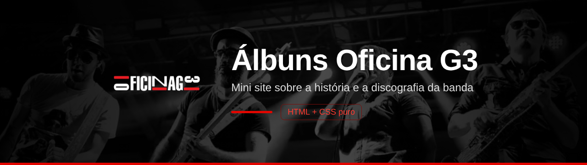

<br><br>


**[🌐 Ver o site ao vivo](https://kaiquednzz.github.io/albuns-oficinag3/)**

</div>

---

## 🎸 Sobre o projeto

Mini site sobre a história e a discografia da banda **Oficina G3**. Ele reúne os álbuns de estúdio e ao vivo, cada um com uma página própria contendo a capa, o texto sobre o disco, a tracklist e os players do Spotify e do Apple Music para ouvir na hora.

Foi um dos meus primeiros projetos de estudo em desenvolvimento web, feito só com HTML e CSS para treinar estrutura de páginas, estilização, responsividade e organização de arquivos. Sem framework, sem build, sem dependência nenhuma.

## 📸 Preview

<div align="center">

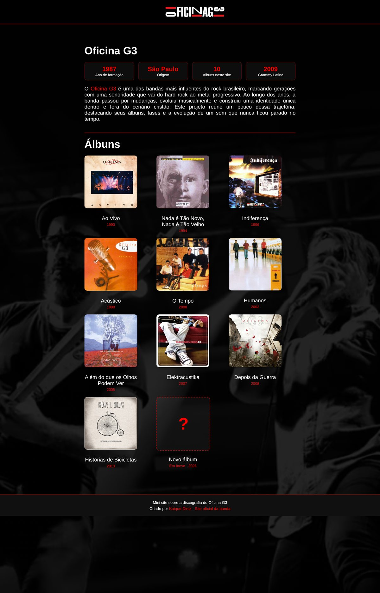

<sub>Página inicial: apresentação da banda e grade com todos os álbuns</sub>

<br><br>

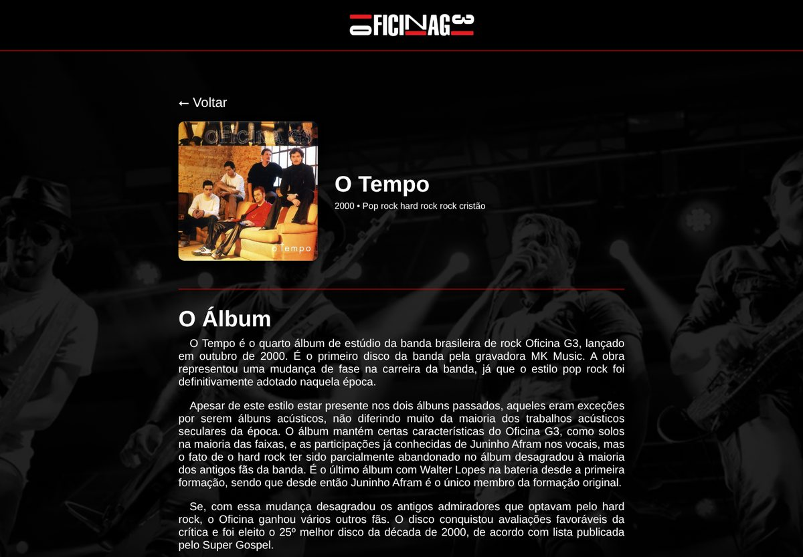

<sub>Página de álbum: capa, texto sobre o disco, tracklist e players</sub>

<br><br>

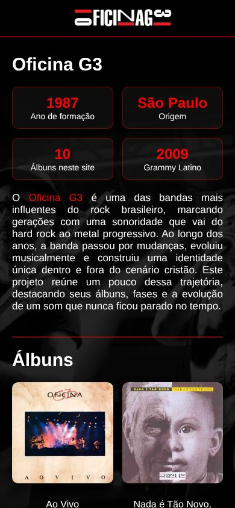
&nbsp;&nbsp;&nbsp;
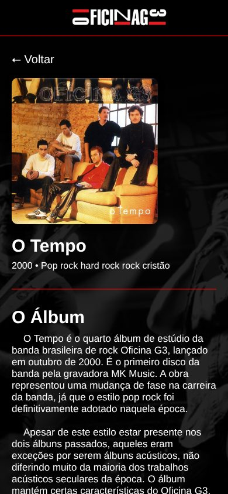

<sub>Versão mobile</sub>

</div>

## 💿 Discografia no site

<div align="center">

<table>
  <tr>
    <td align="center"><a href="https://kaiquednzz.github.io/albuns-oficinag3/pages/ao-vivo.html">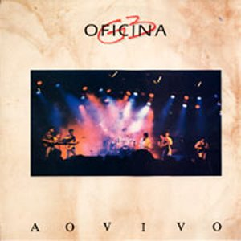</a><br><sub><b>Ao Vivo</b><br>1990</sub></td>
    <td align="center"><a href="https://kaiquednzz.github.io/albuns-oficinag3/pages/nada-e-velho.html"></a><br><sub><b>Nada é Tão Novo,<br>Nada é Tão Velho</b><br>1994</sub></td>
    <td align="center"><a href="https://kaiquednzz.github.io/albuns-oficinag3/pages/indiferenca.html">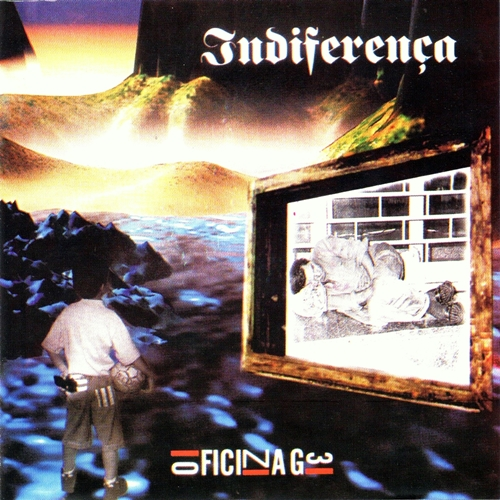</a><br><sub><b>Indiferença</b><br>1996</sub></td>
    <td align="center"><a href="https://kaiquednzz.github.io/albuns-oficinag3/pages/acustico.html">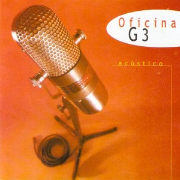</a><br><sub><b>Acústico</b><br>1998</sub></td>
    <td align="center"><a href="https://kaiquednzz.github.io/albuns-oficinag3/pages/o-tempo.html">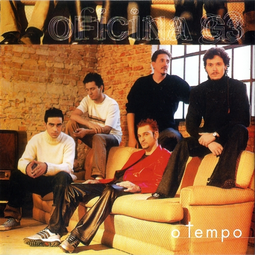</a><br><sub><b>O Tempo</b><br>2000</sub></td>
  </tr>
  <tr>
    <td align="center"><a href="https://kaiquednzz.github.io/albuns-oficinag3/pages/humanos.html">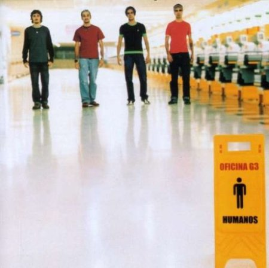</a><br><sub><b>Humanos</b><br>2002</sub></td>
    <td align="center"><a href="https://kaiquednzz.github.io/albuns-oficinag3/pages/alem-do-que-os-olhos.html">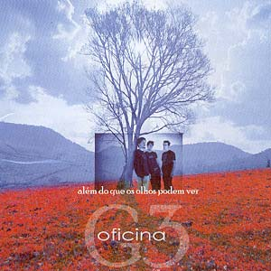</a><br><sub><b>Além do que os<br>Olhos Podem Ver</b><br>2005</sub></td>
    <td align="center"><a href="https://kaiquednzz.github.io/albuns-oficinag3/pages/elektracustica.html">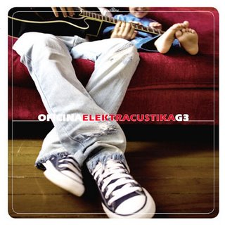</a><br><sub><b>Elektracustika</b><br>2007</sub></td>
    <td align="center"><a href="https://kaiquednzz.github.io/albuns-oficinag3/pages/depois-da-guerra.html"></a><br><sub><b>Depois da Guerra</b><br>2008</sub></td>
    <td align="center"><a href="https://kaiquednzz.github.io/albuns-oficinag3/pages/h%26b.html"></a><br><sub><b>Histórias de Bicicletas</b><br>2013</sub></td>
  </tr>
</table>

</div>

## ✨ O que tem por dentro

- Página inicial com apresentação da banda, fatos rápidos e grade de álbuns
- Uma página para cada álbum, com capa, gêneros, descrição e tracklist numerada
- Players do Spotify e do Apple Music embutidos em cada disco
- Layout responsivo, com ajustes para tablet e celular
- Tema escuro com fundo de show e detalhes em vermelho, na identidade da banda
- Todo o conteúdo em português do Brasil

## 🛠️ Tecnologias

| Tecnologia | Uso |
| --- | --- |
| **HTML5** | Estrutura semântica das páginas (`header`, `main`, `section`, `footer`) |
| **CSS3** | Estilização, grid e flexbox, media queries para responsividade |
| **Google Fonts** | Fonte Raleway |
| **Spotify e Apple Music** | Players embutidos via `iframe` |

## 📁 Estrutura

```
albuns-oficinag3/
├── index.html          # Página inicial
├── pages/              # Uma página HTML por álbum
├── style/
│   └── style.css       # Estilo único compartilhado por todas as páginas
├── script/
│   └── script.js
├── images/             # Capas dos álbuns, logo e imagem de fundo
└── docs/               # Imagens usadas neste README
```

## 🚀 Como rodar localmente

Não precisa instalar nada. Clone o repositório e abra o `index.html` no navegador:

```bash
git clone https://github.com/kaiquednzz/albuns-oficinag3.git
cd albuns-oficinag3
```

Se preferir servir por um servidor local:

```bash
python3 -m http.server 8000
```

Depois é só acessar `http://localhost:8000`.

## 📚 O que aprendi

- Montar a estrutura de um site com várias páginas reaproveitando o mesmo padrão
- Organizar um CSS único para o projeto inteiro, separado por seções
- Deixar o layout responsivo com media queries
- Incorporar conteúdo externo com `iframe`
- Cuidar de caminhos relativos entre páginas e pastas

## 📄 Licença

Distribuído sob a licença MIT. Veja o arquivo [LICENSE](LICENSE) para mais detalhes.

## 👤 Autor

**Kaique Diniz**

[](https://github.com/kaiquednzz)

---

<div align="center">
<sub>Projeto feito para estudo. Oficina G3 é uma banda brasileira, e as capas e os nomes pertencem aos seus respectivos donos. Site oficial: <a href="https://oficinag3.com.br">oficinag3.com.br</a></sub>
</div>
